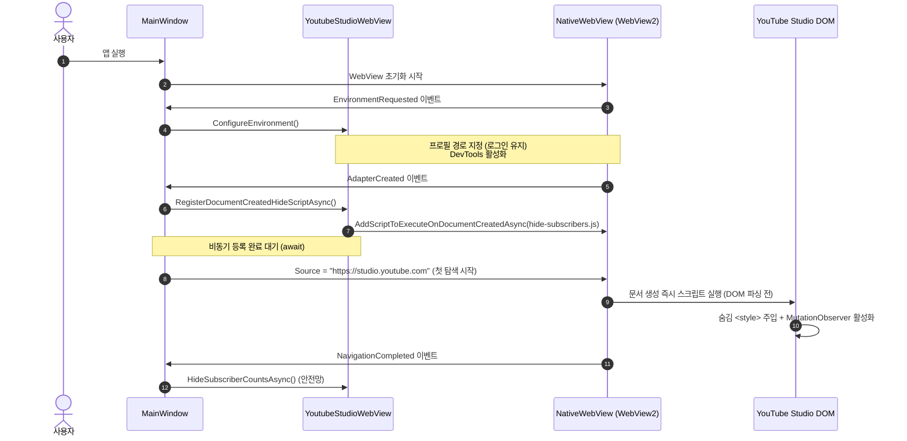

# 아키텍처 및 동작 원리

이 문서는 YouTube Studio Custom 애플리케이션의 내부 구조, 컴포넌트 간 책임, WebView2 라이프사이클 및 구독자 수 숨김 메커니즘을 설명합니다.

---

## 1. 코드 구조

```
youtube studio custom/
  Program.cs              앱 진입점 (Avalonia 부트스트랩)
  App.axaml(.cs)           Application 시작, MainWindow 생성
  MainWindow.axaml(.cs)    창 하나, NativeWebView 컨트롤 하나, 이벤트 배선
  YoutubeStudioWebView.cs  WebView2 환경설정 + 구독자 수 숨김 로직
  Scripts/
    hide-subscribers.js    실제로 구독자 수를 숨기는 JS (임베디드 리소스로 빌드에 포함)
```

각 파일의 역할과 책임은 명확히 분리되어 있습니다:

- [**`Program.cs`**](file:///h:/source/repos/youtube%20studio%20custom/youtube%20studio%20custom/Program.cs): `BuildAvaloniaApp()`으로 Avalonia를 부트스트랩하는 표준 진입점입니다.
- [**`App.axaml.cs`**](file:///h:/source/repos/youtube%20studio%20custom/youtube%20studio%20custom/App.axaml.cs): `OnFrameworkInitializationCompleted`에서 `MainWindow`를 만들어 데스크톱 라이프타임에 연결합니다.
- [**`MainWindow.axaml`**](file:///h:/source/repos/youtube%20studio%20custom/youtube%20studio%20custom/MainWindow.axaml): 단일 창에 `NativeWebView` 컨트롤 하나를 배치하고, `EnvironmentRequested`, `AdapterCreated`, `NavigationCompleted` 세 이벤트를 코드비하인드로 연결합니다.
- [**`MainWindow.axaml.cs`**](file:///h:/source/repos/youtube%20studio%20custom/youtube%20studio%20custom/MainWindow.axaml.cs): 위 세 이벤트 핸들러를 정의합니다. 실제 WebView2 관련 로직은 모두 `YoutubeStudioWebView`에 위임하며, 창 레벨에서는 "언제 무엇을 호출할지" 순서만 조율합니다.
- [**`YoutubeStudioWebView.cs`**](file:///h:/source/repos/youtube%20studio%20custom/youtube%20studio%20custom/YoutubeStudioWebView.cs): WebView2 전용 헬퍼 클래스입니다. 세션 유지를 위한 환경설정과 구독자 수 숨김 스크립트 사전 등록을 담당합니다.
- [**`Scripts/hide-subscribers.js`**](file:///h:/source/repos/youtube%20studio%20custom/youtube%20studio%20custom/Scripts/hide-subscribers.js): 알려진 구독자 수 관련 CSS 선택자들을 가리는 스타일 태그를 주입하고, SPA 라우팅에도 유지되도록 `MutationObserver`를 설정합니다. 어셈블리 내 임베디드 리소스로 포함되어 있습니다.

---

## 2. 수명 주기 및 동작 흐름



1. **환경 설정 (`EnvironmentRequested`)**:
   `YoutubeStudioWebView.ConfigureEnvironment`에서 개발자 도구(F12)를 켜고, 프로필 저장 경로를 `%LocalAppData%\YoutubeStudioCustom\WebView2`로 지정합니다. 이로써 앱을 재시작해도 로그인 세션이 그대로 유지됩니다.
2. **어댑터 생성 및 스크립트 선등록 (`AdapterCreated`)**:
   컨트롤러 생성 시점에 `YoutubeStudioWebView.RegisterDocumentCreatedHideScriptAsync`를 호출하여 숨김 스크립트를 문서 생성 시점 사전 실행 스크립트로 등록합니다.
   > [!IMPORTANT]
   > 첫 탐색(`WebView.Source = "https://studio.youtube.com"`)은 스크립트 선등록이 완전히 끝난 **뒤**에 시작해야 합니다. 그렇지 않으면 등록 전에 첫 페이지 파싱이 시작되어 구독자 수가 찰나의 순간 노출될 수 있습니다.
3. **탐색 완료 후 안전망 (`NavigationCompleted`)**:
   네비게이션이 완료될 때마다 `InvokeScript`로 스크립트를 한 번 더 실행합니다. 이는 예외적인 환경에서 문서 생성 시점 등록이 누락될 경우를 대비한 2차 안전망입니다.

---

## 3. 스크립트 이중 등록 전략

### 문서 생성 시점 (`AddScriptToExecuteOnDocumentCreatedAsync`)
- 새 문서가 만들어지는 즉시, 즉 **HTML이 파싱되기 전**에 브라우저 엔진 레벨에서 실행됩니다.
- 페이지의 본문이 렌더링되기 전에 CSS 규칙이 먼저 존재하므로, 구독자 수 숫자가 단 1프레임도 화면에 노출되지 않습니다.
- 한 번 등록하면 이후의 모든 새로고침, 내부 프레임 네비게이션 시에도 자동으로 적용됩니다.

### 네비게이션 완료 시점 (`InvokeScript` via `NavigationCompleted`)
- 플랫폼 핸들 획득 실패 등 특수한 예외 상황이 발생했을 때를 대비한 백업 안전망으로 유지됩니다.

---

## 4. SPA(Single Page Application) 대응

YouTube Studio는 페이지 전체를 새로고침하지 않고 클라이언트 사이드에서 화면을 교체하는 SPA 구조입니다.

- `hide-subscribers.js` 내부에서 `MutationObserver`를 `document`에 연결해 자식 트리 변경(`childList: true, subtree: true`)을 지속적으로 감시합니다.
- 화면이 갱신되어 스타일 태그가 제거되거나 새로운 구독자 관련 컴포넌트가 동적으로 생성되어도 즉시 숨김 스타일을 재적용합니다.
